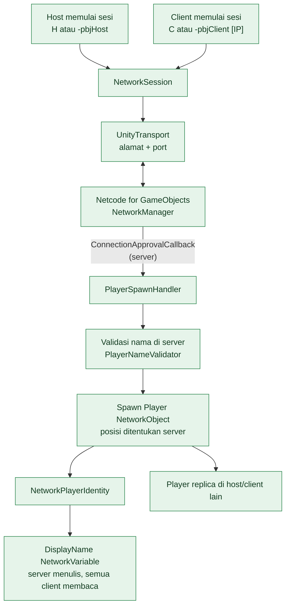
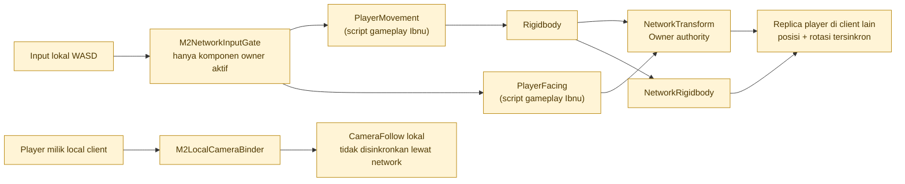
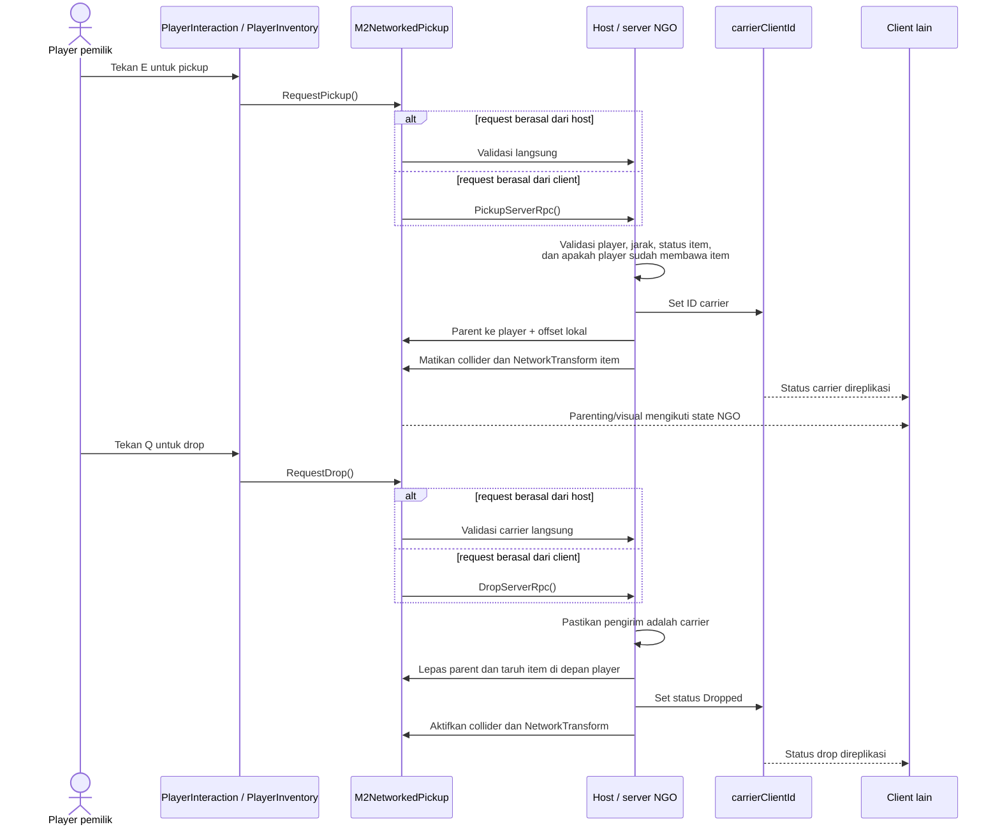

# Diagram Arsitektur Sistem Abim — PBJ

Dokumen ini merangkum sistem networking pada branch `programmer/systems`. Diagram membedakan implementasi yang sudah ada, prototype pengujian, dan rencana Relay agar statusnya tidak tertukar.

## 1. Fondasi Host/Client dan spawn pemain

Sumber utama: `Assets/_Project/Systems/Networking/NetworkSession.cs`, `Assets/_Project/Systems/Players/PlayerSpawnHandler.cs`, dan `Assets/_Project/Systems/Players/NetworkPlayerIdentity.cs`.



Alur ini menggunakan Direct IP/LAN melalui Unity Transport. Server menyetujui koneksi dan membuat player. Nama player yang diterima melalui payload divalidasi di server sebelum disimpan pada `NetworkPlayerIdentity`.

## 2. Sinkronisasi movement dan camera pada prototype M2

Sumber utama: [M1-06 NetworkMovementTest README](M1-06_NetworkMovementTest/README.md) dan [M2 Multiplayer Integration README](M2_MultiplayerIntegration/README.md).



**Penting:** `M2_MultiplayerIntegration` adalah lingkungan uji, bukan scene production. `TemporaryPlayerMovement` di M1-06 juga hanya test driver sementara. Pada prototype M2, `M2NetworkInputGate` mencegah replica memproses input lokal; `M2LocalCameraBinder` menghubungkan kamera tiap instance ke player milik instance itu sendiri.

## 3. Alur pickup/drop item yang disinkronkan (M2-02)

Sumber utama: `M2NetworkedPickup.cs` dan bagian “M2-02 networked pickup/drop” di [README integrasi M2](M2_MultiplayerIntegration/README.md).



Aturan yang perlu dipertahankan:
- Server menjadi otoritas pickup/drop dan memvalidasi pengirim serta jarak.
- Item tetap server-owned. `carrierClientId` menyimpan siapa yang membawa item.
- Tidak memakai ClientRpc untuk visual; state network dan parenting NGO menyebarkan hasilnya.
- Saat item dibawa, NetworkTransform item dimatikan agar tidak melawan transform parent. Saat drop, komponen itu aktif kembali.

## 4. Online Relay (rencana M3, belum ditandai sebagai implementasi)

Sumber: [M3 Online Relay PLAN](M3_OnlineRelay/PLAN.md). Diagram ini adalah target yang direncanakan, bukan klaim bahwa integrasi Relay sudah selesai.

```mermaid
flowchart LR
    HostUI["Host: nama + Create Room"] --> OnlineSession["OnlineSession<br/>(direncanakan)"]
    ClientUI["Client: nama + join code"] --> OnlineSession
    OnlineSession --> UGS["Unity Authentication +<br/>Multiplayer Services"]
    UGS --> Relay["Unity Relay"]
    Relay --> Transport["UnityTransport"]
    Transport --> NGO["Netcode for GameObjects"]
    NGO --> Existing["Sistem PBJ yang sudah ada<br/>spawn, identity, gameplay M2"]

    classDef planned fill:#fce8e6,stroke:#c0392b,color:#5b1712,stroke-dasharray: 5 5;
    class HostUI,ClientUI,OnlineSession,UGS,Relay,Transport planned;
    class NGO,Existing fill:#e6f4ea,stroke:#27834a,color:#123b20;
```

Menurut audit yang dicatat di PLAN M3, integrasi OnlineSession/Relay memerlukan setup Unity Gaming Services dan package terkait. Pertahankan Direct IP/LAN yang ada sebagai jalur terpisah sampai Relay diuji.

## Status ringkas

| Bagian | Status pada dokumentasi repo |
|---|---|
| Direct IP/LAN via `NetworkSession` + UnityTransport | Implementasi ada |
| Server-authoritative approval/spawn + identity pemain | Implementasi ada |
| NetworkTransform movement proof M1-06 | Prototype test |
| Camera ownership gate dan network pickup/drop M2 | Prototype integrasi test |
| Online Relay melalui UGS Multiplayer Services | Rencana M3 di `PLAN.md` |

