# Diagram Aset UI — Aul

Dokumen ini memetakan aset yang tercatat pada branch `artist/aul`. Diagram merupakan peta pengelompokan aset, bukan bukti bahwa setiap file sudah terhubung di Inspector atau runtime.

```mermaid
flowchart TD
    Root["Assets/Playground/Aul"] --> Scene["UI.unity<br/>scene UI/prototype"]
    Root --> Menu["main  menu/"]
    Root --> Lobby["lobby/"]
    Root --> Health["Health/"]
    Root --> GameState["Aset game state"]
    Root --> Texts["texts/"]

    Menu --> MainIllustration["UI_Illustrasi_MainMenu.png"]
    Menu --> NavButtons["host_option / join_option / back_button / quitbutton"]
    Menu --> Inputs["nameinput / codeinput / joincode"]
    Lobby --> Code["codedisplay.png"]
    Lobby --> Crew["crewlist.png"]
    Health --> H0["health0.png"]
    Health --> H1["health1.png"]
    Health --> H2["health2.png"]
    Health --> H3["health3.png"]
    GameState --> Pause["pause button2.png"]
    GameState --> Lose["loseskeleton.png"]
    Texts --> Title["titletext.png"]
    Texts --> Over["gameovertext.png"]

    classDef folder fill:#e5f0ff,stroke:#3267a8,color:#102b4d;
    classDef asset fill:#e9f7ec,stroke:#27834a,color:#123b20;
    class Root,Scene,Menu,Lobby,Health,GameState,Texts folder;
    class MainIllustration,NavButtons,Inputs,Code,Crew,H0,H1,H2,H3,Pause,Lose,Title,Over asset;
```

## Inventaris berdasarkan folder

| Kelompok | Isi yang ditemukan | Tujuan yang tersirat dari nama aset |
|---|---|---|
| Main menu | Ilustrasi menu, host/join, back, quit, input nama/kode | Navigasi dan form menu |
| Lobby | `codedisplay.png`, `crewlist.png` | Tampilan kode room dan daftar pemain |
| Health | `health0.png` sampai `health3.png` | Variasi indikator health |
| Pause/game over | `pause button2.png`, `loseskeleton.png` | Tombol pause dan visual kalah |
| Text | `titletext.png`, `gameovertext.png` | Judul dan pesan game over |

Nama file memberi petunjuk fungsi aset, tetapi penggunaan sebenarnya perlu dikonfirmasi pada scene/prefab dan Inspector Unity.
