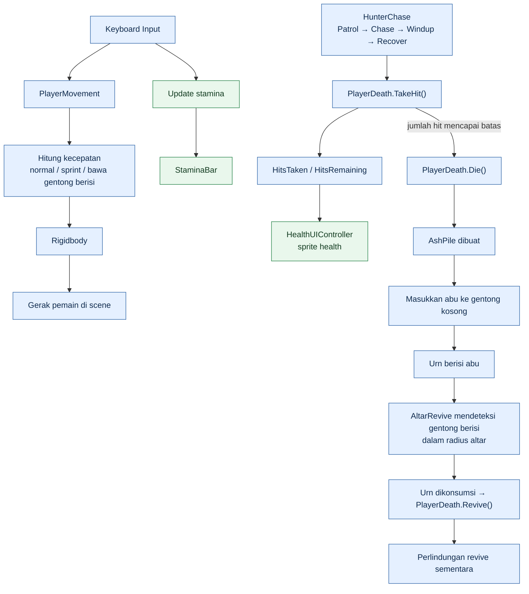
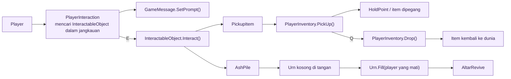
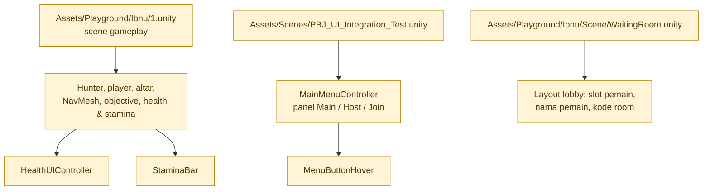

# Diagram Sistem Gameplay — Ibnu

Diagram ini dibuat dari script dan scene yang ada di branch `programmer/mechanics`. Ini menjelaskan hubungan sistem berdasarkan kode; bukan klaim bahwa semua alur sudah diuji runtime.

## 1. Loop gameplay utama

## 2. Interaksi dan inventory

## 3. Peta scene dan UI

Catatan: `WaitingRoom.unity` menunjukkan layout UI di branch mechanics. Integrasi sesi/network multiplayer berada pada branch `programmer/systems`; diagram ini tidak menganggap layout scene tersebut sudah terhubung ke session networking.

## Script utama

- `HunterChase.cs`: patroli, mengejar, windup serangan, recover.
- `PlayerDeath.cs`: hit, mati, sembunyi renderer/collider, revive, proteksi setelah revive.
- `AshPile.cs`, `Urn.cs`, `AltarRevive.cs`: alur abu sampai revive.
- `PlayerInteraction.cs`, `InteractableObject.cs`, `Pickupitem.cs`, `PlayerInventory.cs`: interaksi, pickup, bawa, dan drop.
- `PlayerMovement.cs`, `StaminaBar.cs`: gerak, sprint, stamina, dan indikator.
- `HealthUIController.cs`: memperbarui sprite health berdasarkan hit yang tersisa.
- `MainMenuController.cs`, `MenuButtonHover.cs`: navigasi panel dan animasi hover.
- `RandomSpawner.cs`, `BlockoutBuilder.cs`: penempatan item/objek dan pembuatan blockout level.
