# Diagram Aset Karakter dan Lingkungan — Linda

Diagram ini memetakan kelompok aset pada branch `artist/linda`. Ini adalah struktur library art, bukan diagram runtime Animator atau bukti bahwa semua sprite sudah terpasang di scene.

```mermaid
flowchart TD
    Root["Assets/Playground/Linda"] --> Final["Character-sprite-final/"]
    Root --> Parts["Player-sprite/"]
    Root --> Shaman["Shaman/"]
    Root --> Env["Environment/"]
    Root --> Offer["Offerings/"]
    Root --> Anim["animation/"]

    Final --> FoxFinal["Fox: front / back / right"]
    Final --> GoatFinal["Goat: front / back / right"]
    Final --> RabbitFinal["Rabbit: front / back / right"]
    Final --> SquirrelFinal["Squirrel: front / back / right"]
    Final --> ShamanFinal["Shaman-final.png"]

    Parts --> FoxParts["Fox: body, head, hands, legs"]
    Parts --> GoatParts["Goat: body, head, hands, legs"]
    Parts --> RabbitParts["Rabbit: body, head, hands, legs"]
    Parts --> SquirrelParts["Squirrel: body, head, hands, legs"]
    Shaman --> ShamanParts["Body, head, left leg, right leg"]

    Env --> Nature["Grass, trees, stones, bonfire"]
    Env --> Ritual["Shaman's Hut, Offering Board,<br/>Resurrection Ritual"]
    Offer --> Items["Feather, Fossil, Horn, Meat,<br/>Skull, Stone, Strange-fruit, Wheat, Wood"]
    Anim --> Controllers["Player-fox-front_0.controller<br/>Player-fox-right_0.controller"]
    Anim --> Clips["fox-idle, fox-idle-bring-item,<br/>fox-walk-right"]

    classDef folder fill:#e5f0ff,stroke:#3267a8,color:#102b4d;
    classDef group fill:#e9f7ec,stroke:#27834a,color:#123b20;
    class Root,Final,Parts,Shaman,Env,Offer,Anim folder;
    class FoxFinal,GoatFinal,RabbitFinal,SquirrelFinal,ShamanFinal,FoxParts,GoatParts,RabbitParts,SquirrelParts,ShamanParts,Nature,Ritual,Items,Controllers,Clips group;
```

## Peta isi

- **Character-sprite-final**: sprite hasil akhir untuk Fox, Goat, Rabbit, Squirrel dari arah depan, belakang, dan samping kanan, serta `Shaman-final.png`.
- **Player-sprite**: komponen karakter modular yang dipisahkan menjadi body, head, tangan, dan kaki untuk tiap hewan dan arah.
- **Shaman**: bagian tubuh Shaman terpisah.
- **Environment**: rumput, pohon, batu, api unggun, pondok Shaman, papan persembahan, dan ritual revive.
- **Offerings**: sembilan jenis item persembahan.
- **animation**: dua Animator Controller dan tiga clip animasi Fox yang tercatat di branch ini.

Penggunaan sprite modular, sprite final, dan clip animasi bersama-sama perlu ditentukan di prefab/Animator saat integrasi art.
