# Diagram Library Audio — Nesya

Dokumen ini mengelompokkan file audio yang ada pada branch `artist/nesya` berdasarkan nama dan kemungkinan fungsi. Branch ini berisi aset audio; diagram tidak menyatakan bahwa setiap clip sudah dipasang ke AudioSource atau dipanggil oleh script game.

```mermaid
flowchart TD
    Root["Assets/Playground/Nesya"] --> Music["Musik"]
    Root --> Ambience["Ambience"]
    Root --> UI["UI SFX"]
    Root --> World["Environment SFX"]
    Root --> Player["Player / gameplay SFX"]
    Root --> Creature["Monster SFX"]

    Music --> Main["main menu.mp3"]
    Music --> MainAlt["main menu no chant.mp3"]
    Ambience --> Forest["forest ambience.mp3"]
    Ambience --> Danger1["forest ambience danger.mp3"]
    Ambience --> Danger2["forest ambience danger2.mp3"]
    Ambience --> Fire["fire crackle.mp3"]
    UI --> Button["button.mp3"]
    UI --> ButtonBase["button ui base.mp3"]
    World --> Bush["bush.mp3"]
    World --> WalkBush["walk into bush.mp3"]
    Player --> Walk1["walk1.mp3"]
    Player --> Walk2["walk2.mp3"]
    Player --> Dead["dead_debu.mp3"]
    Player --> Revival["revival.mp3"]
    Creature --> Growl1["monstergrowl1.mp3"]
    Creature --> Growl2["monstergrowl2.mp3"]

    classDef folder fill:#e5f0ff,stroke:#3267a8,color:#102b4d;
    classDef asset fill:#e9f7ec,stroke:#27834a,color:#123b20;
    class Root,Music,Ambience,UI,World,Player,Creature folder;
    class Main,MainAlt,Forest,Danger1,Danger2,Fire,Button,ButtonBase,Bush,WalkBush,Walk1,Walk2,Dead,Revival,Growl1,Growl2 asset;
```

## Inventaris

| Kelompok | File |
|---|---|
| Musik menu | `main menu.mp3`, `main menu no chant.mp3` |
| Ambience | `forest ambience.mp3`, `forest ambience danger.mp3`, `forest ambience danger2.mp3`, `fire crackle.mp3` |
| UI | `button.mp3`, `button ui base.mp3` |
| Lingkungan | `bush.mp3`, `walk into bush.mp3` |
| Player/gameplay | `walk1.mp3`, `walk2.mp3`, `dead_debu.mp3`, `revival.mp3` |
| Monster | `monstergrowl1.mp3`, `monstergrowl2.mp3` |

Nama file digunakan sebagai dasar pengelompokan. Penetapan trigger, volume, looping, dan prioritas audio harus dikonfirmasi saat integrasi di scene.
